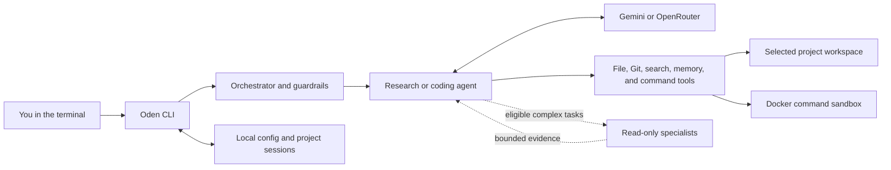

<div align="center">


# Oden

### A terminal coding agent that works inside your project

Research, edit files, and run approved commands with Gemini or OpenRouter—while Oden keeps the work scoped to your selected workspace.

[](https://www.npmjs.com/package/oden-agent)


[](https://github.com/kaiju-no-9/notebookcli/actions/workflows/ci.yml)

</div>

---

## What is Oden?

Oden is an autonomous terminal agent harness for coding and research tasks. Start it in a project, describe the change, and Oden can inspect the workspace, search for information, edit files, and use a Docker sandbox for shell commands. It supports **OpenRouter** and **Google Gemini**.

Oden is designed to make agent work understandable and bounded: it streams progress in the terminal, asks before sensitive or higher-risk actions, and keeps project conversations in separate sessions.

## Features

| Capability | What Oden does |
|---|---|
| **Coding agent** | Reads project files, creates and edits code, and runs commands in a Docker sandbox. |
| **Gemini and OpenRouter** | Select a provider and model in setup or with `/provider`. |
| **Live terminal updates** | Streams provider text and shows concise tool and specialist activity while a task runs. |
| **Workspace boundaries** | Choose a project from a native folder dialog, recent folders, the current folder, or a typed path. File and Git tools use the selected workspace. |
| **Human approval** | Review and approve confirmation-class shell and Git commands, package installs, overwrites, and sensitive file writes. Hard-blocked commands cannot be approved. |
| **Persistent sessions** | Keep separate conversation histories per project; create, switch, and delete sessions with `/sessions`. |
| **Complex-task specialists** | For eligible multi-part coding tasks, Oden can ask bounded, read-only specialists to inspect and plan. The parent agent remains the only writer. |
| **Web and memory tools** | Search with fallback providers or configure Tavily. Connect Supermemory for explicit memory save and recall. |
| **Secret-aware configuration** | Store provider and service credentials through the OS keychain when available, with an encrypted local-file fallback. Logs redact recognized secrets. |

## How it works



The selected workspace is shared by file tools, Git, sessions, and the Docker mount. Oden rejects file access that escapes the workspace through `..` or symlinks, and file tools do not read credential-like files such as `.env`.

## Technology

- **TypeScript** with strict type checking
- **Bun** as the application runtime
- **Google Gemini** and **OpenRouter** provider integrations
- **Docker Compose** for sandboxed command execution
- **Zod** for runtime validation
- **Bun test** for the test suite

## Install and run

### Requirements

- Node.js **20.17 or later** to run the npm launcher
- Bun **1.1 or later** to run Oden
- Docker with Docker Compose and Buildx for sandboxed command execution
- An OpenRouter API key or Google Gemini API key

### Install the tested npm release

```sh
npm install --global oden-agent@1.0.0
```

Run Oden from the project you want to work on:

```sh
cd /path/to/your/project
oden
```

On first launch, select a workspace and configure a provider with `/provider`. Oden can use an existing environment key or securely prompt for one. Start with `oden --help` to see CLI options.

> The install command is pinned to `1.0.0` so it selects the release tested with this README. When a newer stable release is available, install its explicit version. Uninstall with:
>
> ```sh
> npm install --global oden-agent@<version>
> npm uninstall --global oden-agent
> ```

## First session

```text
oden
/provider
/status
Create a small test file that says hello.
/sessions
quit
```

Review approval prompts before allowing changes. For command execution, make sure Docker is running; the sandbox image can be built with `docker compose build sandbox` from the Oden source checkout.

## CLI commands

| Command | Purpose |
|---|---|
| `/provider` | Choose Gemini or OpenRouter, configure a key if needed, and select a supported model. |
| `/web` | Configure Tavily for web search; fallback search remains available without a key. |
| `/memory` | Connect Supermemory using a hidden API-key prompt. |
| `/delete` | Remove a saved provider or service key. |
| `/sessions` | Create, switch, or delete project-scoped conversation sessions. |
| `/status` | Show the active provider, model, workspace, and configured services; keys are masked. |
| `/help` | List available commands. |
| `exit` or `quit` | Leave Oden. |

CLI options:

```sh
oden --provider gemini
oden --provider openrouter
oden --model <model-name>
oden --workspace /absolute/path/to/project
```

OpenRouter defaults to `openrouter/free`. Gemini defaults to `gemini-3.8-flash`. Use `/provider` to change the provider or model interactively.

## Workspace selection

In an interactive terminal, Oden offers the current folder, recent folders, a native system folder dialog, manual path entry, and cancellation. It uses the current folder by default only in non-interactive runs.

You can skip the picker with an environment variable or CLI option:

```sh
ODEN_WORKSPACE=/absolute/path/to/project oden
oden --workspace /absolute/path/to/project
```

macOS uses AppleScript for the folder dialog, Windows uses PowerShell and Windows Forms, and Linux tries Zenity then KDialog. If a desktop dialog is unavailable, Oden offers manual path entry.

## Providers and optional services

Set provider keys through Oden's `/provider` flow, or provide environment variables:

```sh
OPENROUTER_API_KEY=your-key
GEMINI_API_KEY=your-key
```

Gemini accepts classic `AIza…` keys and newer `AQ.…` authorization keys. OpenRouter is the default provider. Environment model settings include `OPENROUTER_MODEL`, `OPENROUTER_GUARD_MODEL`, `GEMINI_MODEL`, and `GEMINI_GUARD_MODEL`.

Optional integrations:

| Integration | Setup |
|---|---|
| Tavily web search | Run `/web` and enter a key, or set `TAVILY_API_KEY`. Fallback search works without it. |
| Supermemory | Run `/memory`, or configure `SUPERMEMORY_API_KEY` with `MEMORY_API_URL=https://api.supermemory.ai/v3`. |
| OS keychain | Used when available for credentials. Oden falls back to an encrypted file under `~/.oden`. |

Copy `.env.example` to `.env` for local development. `.env` is ignored by Git; keep API keys private.

## Sessions, budgets, and specialists

Oden resumes the active session for the selected project and saves conversation history after completed turns. Session files live under `~/.oden/sessions/` with owner-only permissions. Recognized secrets are redacted, but conversation text is otherwise stored as plaintext. Sessions share project files; they do not create separate Git worktrees.

Each user turn shares configurable request, token, tool, and time budgets across routing, guardrails, research, coding, and streaming. Defaults and `ODEN_MAX_*` settings are listed in `.env.example`.

For eligible complex coding tasks, Oden may start up to two read-only specialists by default. They share the parent turn's budgets and cannot edit files, execute commands, or use Git. Set `ODEN_MAX_SUBAGENTS=0` to disable delegation, or adjust the cap in the range 1–3.

## Safety and sandbox

Oden asks for approval before confirmation-class shell or Git operations, package installs, overwriting existing files, and sensitive writes. The prompt shows the proposed action and its target. Rejecting, cancelling, timing out, or interrupting denies the operation. Hard-blocked commands—including force pushes and hard resets—cannot be approved.

Commands run in a Docker Compose sandbox with an unprivileged user, dropped Linux capabilities, and configured CPU, memory, and process limits. Start Docker before using command execution. From a source checkout, build the image with:

```sh
docker compose build sandbox
```

## Develop from source

```sh
git clone https://github.com/kaiju-no-9/notebookcli.git
cd notebookcli
bun install
bun run start
```

Common checks:

```sh
bun run typecheck
bun test --parallel=1
bun run build
npm pack --dry-run
```

## Project layout

```text
oden/
├── bin/                 # Node.js shim for the npm-installed `oden` command
├── src/
│   ├── agent/           # Coding and research agent loops
│   ├── cli/             # Terminal UI, workspace picker, slash commands
│   ├── config/          # Providers, models, credentials, run limits
│   ├── guardrails/      # Input/output checks and secret scanning
│   ├── orchestration/   # Routing, run coordination, specialist policy
│   ├── providers/       # Gemini and OpenRouter adapters and streaming
│   ├── sessions/        # Project-scoped persistent sessions
│   ├── tools/           # File, Git, search, memory, and command tools
│   └── utils/           # Workspace context, budgets, shared utilities
├── docker-compose.yaml  # Sandboxed command environment
└── sandbox.Dockerfile   # Sandbox image definition
```

## Documentation

See [`docs/README.md`](docs/README.md) for the implementation roadmap, architecture notes, module specifications, and testing strategy.
